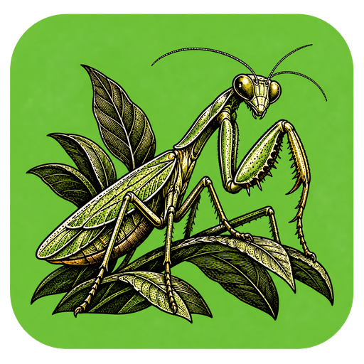
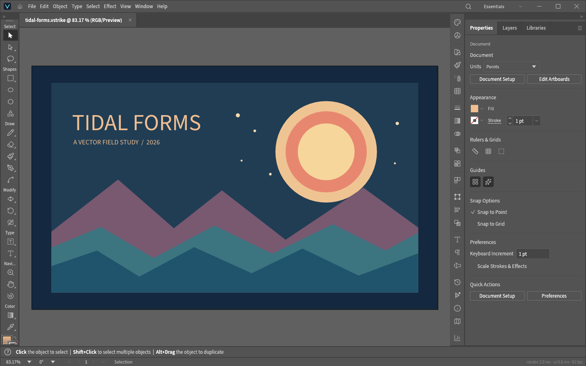
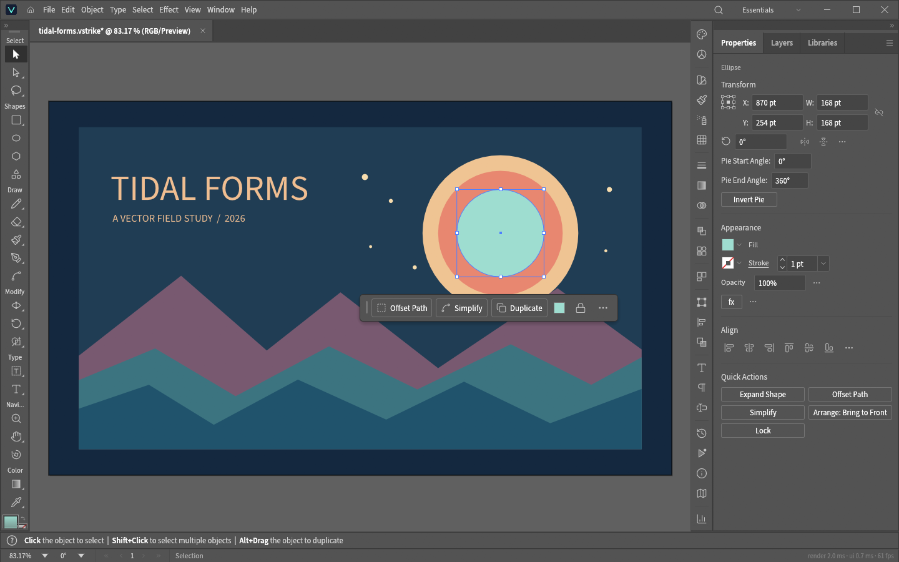
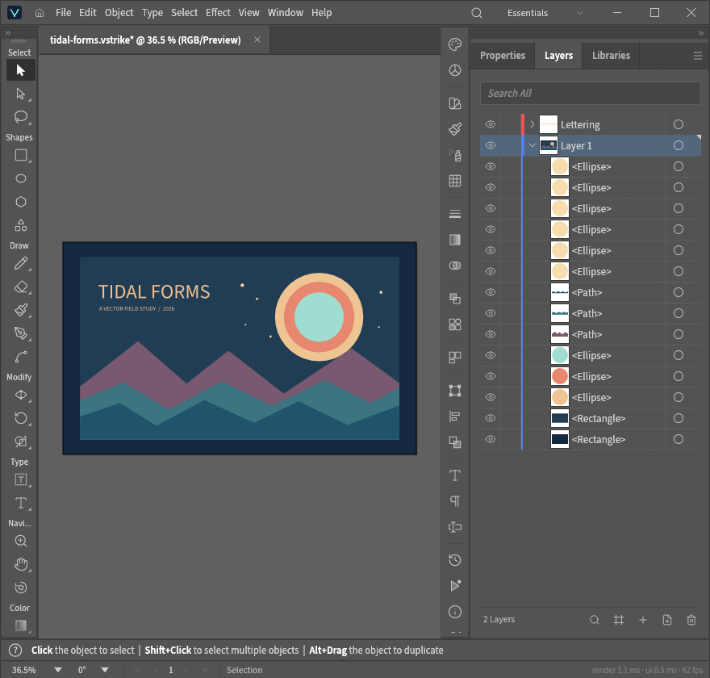

<p align="center">
  
</p>

<h1 align="center">VectorStrike</h1>

<p align="center">
  <a href="https://prowebdevsolutions.com"><picture>
    <source media="(prefers-color-scheme: dark)" srcset="assets/branding/PWDS-logo-orange.svg">
    
  </picture></a>
</p>

<p align="center"><strong>Make every line count.</strong></p>

<p align="center">A native desktop workspace for drawing and revising vector artwork. Build with paths, shapes, type, and layers; save an editable <code>.vstrike</code> document; and export SVG for use elsewhere.</p>

<p align="center"><a href="#inside-the-workspace">Workspace</a> · <a href="#current-status">Current status</a> · <a href="#build-and-verification">Build</a> · <a href="#source-terms-and-attribution">Credits and source terms</a></p>

## Rust direction and migration status

- **Target:** A Rust-native vector editor, extending the selected VectorCraft foundation rather than rewriting its existing Rust implementation.
- **Current implementation:** The [Cargo workspace](Cargo.toml) and [desktop entry point](apps/vectorcraft/src/main.rs) are already Rust, with VectorStrike document and desktop adaptations.
- **Remaining migration:** Continue integration and validation of the existing Rust editor. Broader document fidelity, native interaction, platform acceptance and safe release packaging remain open; the source checkpoint is not a finished migration or release.



*The running Windows source checkpoint at 1440 × 900. “Tidal Forms” is original sample artwork built in VectorStrike for this README, using the app's rectangle, ellipse, path, color, layer, and text commands. No donor or client artwork appears in these captures.*

## Inside the workspace

### Draw a composition from editable parts

The poster is made from separate rectangles, ellipses, closed paths, and text on two layers. It was saved as a `.vstrike` document before the first screenshot. The artwork is a controlled sample of the current editor, not a claim of broad imported-file compatibility.

### Recolor one shape

Select the center ellipse and change its fill to explore another palette. The mint center, selection outline, and Fill property below come from an actual unsaved edit in the running app. The original saved document still has its warm yellow center.



### See the document structure

The Layers panel lists the Lettering layer and the individual shapes and paths in Layer 1. This is a narrower native window with the artboard fitted to its available canvas, captured after the same color edit.



## Current status

VectorStrike is a **Windows source checkpoint**, with no verified installer or general platform acceptance. A retained Windows executable built from the published candidate source was launched and used to make the screenshots above. Its Rust files and `Cargo.lock` match the later local worktree; that worktree has six subsequent manifest license-metadata and Windows version-resource wording differences. This capture verifies the shown workflow, not a new clean-checkout build or broad product acceptance. Legacy donor packaging scripts remain unavailable for VectorStrike.

## Build and verification

The root `Cargo.lock` pins the dependency graph. The root manifest declares Rust 1.95 as its minimum. A fresh checkout needs ordinary crates.io access; `--offline` works only after the registry cache is populated. Leave `CRAFT_FONTS_DIR` unset for a build using only files in this repository.

```powershell
cargo metadata --locked --no-deps --format-version 1
cargo test --locked -p vectorcraft-engine --test vectorstrike_workflow
cargo build --locked -p vectorcraft --bin vectorstrike
```

The focused workflow test covers paths, layers, native save and reopen, undo and redo, and SVG export. The app's control channel requires explicit authentication and scoped read/write roots. An independent operation review covers those controls and queued save completion for an earlier frozen Windows binary. The retained binary used for this README was freshly exercised with a separate original document; it does not replace a clean-checkout build and test. See the [screenshot provenance](docs/SCREENSHOT_PROVENANCE.md) for exact capture and source-match details.

## Source terms and attribution

Original upstream VectorCraft code is provided under its MIT OR Apache-2.0 terms. Keep [`LICENSE-MIT`](LICENSE-MIT), [`LICENSE-APACHE`](LICENSE-APACHE), and [`NOTICE`](NOTICE) with that code. The new VectorStrike modifications and the V-shaped mark still shown inside the retained executable have **no newly granted first-party license stated in this checkout**. That in-app mark differs from the approved original praying-mantis repository logo at [`assets/branding/VectorStrike.png`](assets/branding/VectorStrike.png), shown above. Removed donor artwork is not included.

The root workspace retains upstream SPDX and repository metadata. The 22 unchanged donor packages keep their original inherited SPDX license field. The five packages containing local VectorStrike edits omit a package-level license field; their original upstream portions retain the donor grants. The published Windows version resource names the original upstream copyright and refers to `NOTICE` for VectorStrike changes without asserting a combined-code license. Later local metadata edits are not in this public source checkpoint.

[`ASSETS.md`](ASSETS.md) identifies retained fonts, SVG icons, example art, and the new README screenshots, with their notices and capture provenance. Internal package names and retained upstream copyright remain attributed to VectorCraft authors; they do not assert that the donor work was authored by VectorStrike.

## Packaging status

Legacy VectorCraft bundle, installer, signing, and platform package commands are **unavailable for VectorStrike**. In particular, do not run `cargo xtask bundle` or the scripts under `packaging/` as VectorStrike release steps: they still require removed donor artwork and donor product identifiers. [`packaging/README.md`](packaging/README.md) lists the boundary. The approved repository logo is available; its integration as the executable icon has not been verified, and no installer or release has been approved.

## Source checkpoint

VectorStrike adapts the full [VectorCraft](https://github.com/storytold/vectorcraft) workspace at `231a97dd51a8dc39f62449ee81bc490f7ba9fe5c`. The desktop binary target is `vectorstrike`; internal `vectorcraft-*` names remain. The retained screenshot executable has SHA-256 `89F4B228883FE6845459C33995F23E76FB361A0B50CD5D03A105EB508C56A865`. Its Cargo depfile points to the publication-candidate checkout, and the public source's checked Rust, lockfile, and build metadata match that checkout. The earlier independent operation review used a different executable; see [STRIKE_PROVENANCE.md](STRIKE_PROVENANCE.md) and [screenshot provenance](docs/SCREENSHOT_PROVENANCE.md).

## PWDS brand artwork

The company mark in this masthead is the existing [official PWDS logo](https://github.com/Gerbzz/PWDS-Website/blob/main/public/prowebdevsolutions-logo.png), with the [official orange display asset](https://prowebdevsolutions.com/images/prowebdevsolutions-logo-orange.svg) for dark backgrounds. The app logo above it remains the original Strike suite artwork.
